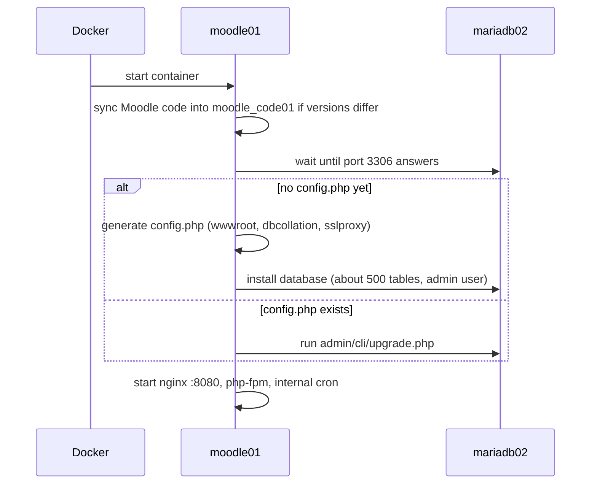

---
tags:
section: infrastructure
kind: reference
---

Ansible ist eine  Technologie, mit der sich eine Server-Infrastruktur managen lässt.  Mit Ansible wird die Server-Konfiguration beschrieben und angewendet. Auch die Server für den VFLL werden mit Ansible konfiguriert.  

Typischer Ansible-Aufruf

