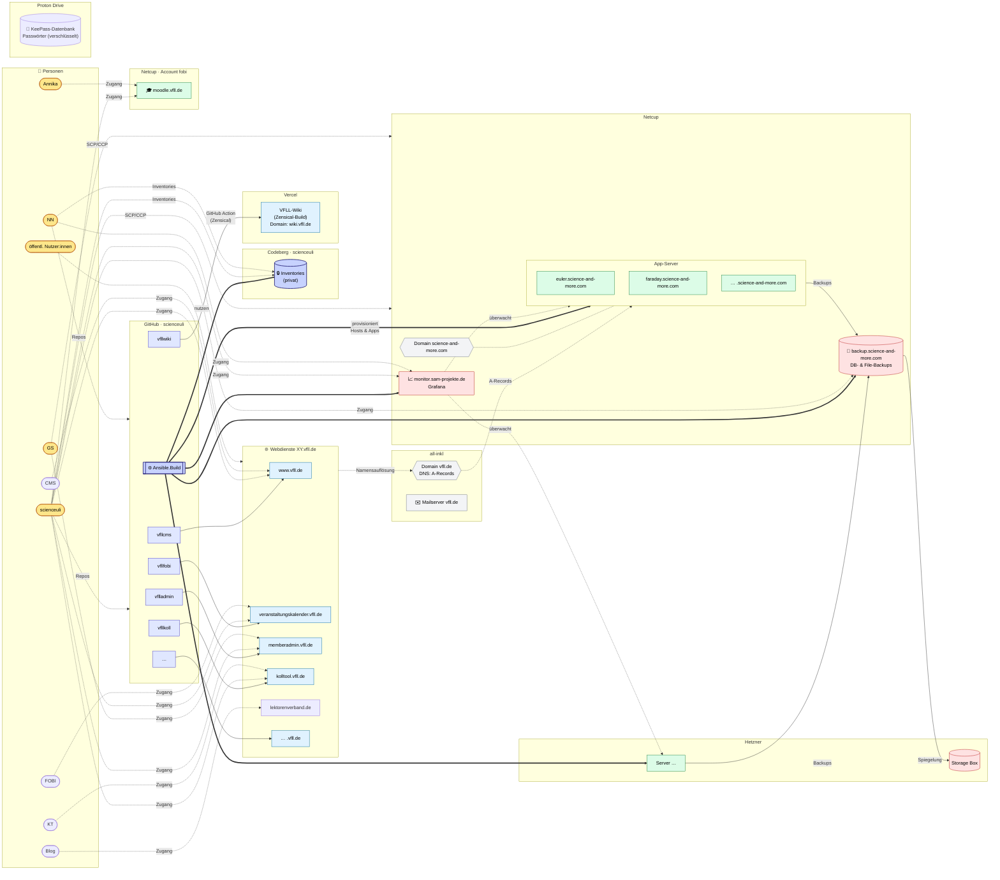

Überblick über Webservices, Servers, User ... der VFLL-IT-Landschaft

### Anmerkungen

- Ein Subgraph pro Provider (GitHub, Codeberg, ProtonDrive, Vercel, all-inkl, Netcup, Netcup·fobi, Hetzner), 
- `XY.vfll.de` steht für die Vfll Web Services. Die Kanten-Stile haben folgende Bedeutungen:

- **Duurchgezogene Pfeile** zeigen Deployments, Backups and Mirror-Flows.
- **Dicke Pfeile** zeigen die Ansible-Orchestrierung. `Ansible.Build` it mit den Inventories auf Codeberg verknüpft.
- **Gepunktete Pfeile** zeigen DNS-Auflösungen, Monitoring and User-Zugänge an.

